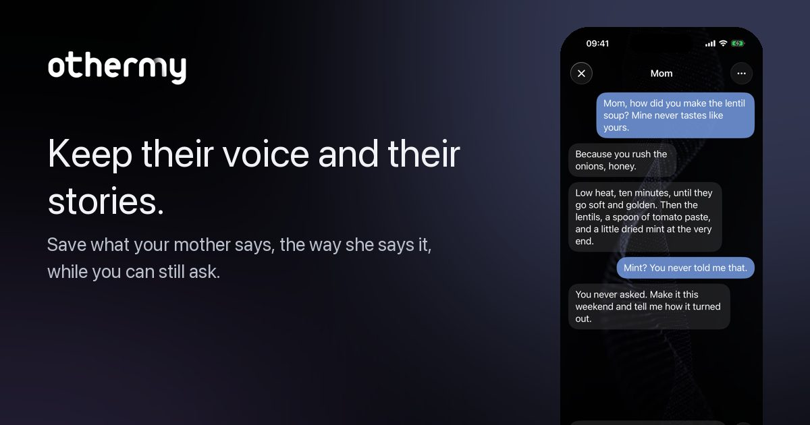

# OtherMy

**Keep a person's stories and the way they talk, so their family can still ask them things.**

OtherMy is an iPhone and iPad app made by [EDROIDA](https://othermy.com/about.html). You build a
*copy* of yourself, or of someone you love (a parent, a grandparent, a friend, still here or
remembered), from their answers to questions, their memories and photos, their voice recordings
and their real chats. The copy answers the way they would, from what it was told, and says so when
it doesn't know.

> A copy is not the person. It doesn't think, feel or continue anyone's life, and it doesn't make
> things up. It's a way to keep asking.

[othermy.com](https://othermy.com) · [Guides](https://othermy.com/guides/) · [Privacy](https://othermy.com/privacy.html) · [AI transparency](https://othermy.com/ai-transparency.html)

## How it works

1. **Start in a few minutes.** Your own copy begins with a short conversation of six questions.
2. **Go deeper when you like.** *Improve My Copy* has 273 questions in 8 chapters, from childhood to
   what matters most. You can answer by talking: the phone writes it out and you check the words
   before anything is saved.
3. **Add the real things.** Memories with photos, voice recordings, and chats exported from WhatsApp
   or Telegram (only the person's own side teaches the copy).
4. **Talk with it.** The copy texts the way the person did, in their words and rhythm, in the
   language you write to it in.

## What's inside

| | |
|---|---|
| **For Someone Else** | Copies of the people you love, with 72 questions about them. Invite up to five family members to help build one, because everyone remembers something different. |
| **Voice, only with consent** | With Premium, a copy can speak in a voice made from the person's own recordings, only with their consent or another legal right. Every call is labelled as a conversation with an AI copy, and the voice can be removed at any time. |
| **Messages for the Future** | Words, photos, a voice note or a video that arrive on a chosen day, or after you're gone once your guardians confirm it. |
| **Guardians** | Up to five people you trust. While you're here they can do nothing; if they report that you've passed away, you get 30 days and several reminders to say you're fine. |
| **Family Tree** | Your family on one map, each person's copy a tap away. |
| **For My Child** | A private notebook of a child's first words and funny moments. It never teaches a copy. |
| **OtherMy for Family** | Family members without an iPhone can talk with the copies they're invited to, and add memories, from any browser. |

## Our promises

- What you share never trains public AI models.
- No ads, and your data is never sold.
- Download everything in one file at any time; delete any part of it, or your whole account.
- If OtherMy ever closes, you hear at least 90 days before, and downloading keeps working until the
  last day.
- We say plainly what it isn't: OtherMy is not end-to-end encrypted, and a copy is not the person.

More in [docs/ethics.md](docs/ethics.md) and the [FAQ](docs/faq.md).

## Status

OtherMy is finished and in testing. It is not in the App Store yet: you can
[join the waitlist on othermy.com](https://othermy.com). It speaks English, German, French, Spanish
and Turkish, and is for people aged 16 and over. See the [roadmap](docs/roadmap.md).

## Contact

support@othermy.com · privacy@othermy.com · security reports: see [SECURITY.md](SECURITY.md)

This repository holds OtherMy's public principles and answers; the app's source code is private.
